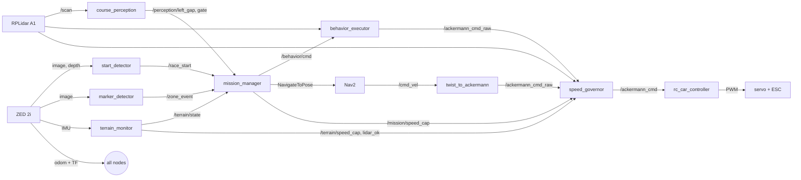

# turbotitans_auto

ROS 2 (Jazzy, Ubuntu 24.04) software for the Turbo Titans autonomous RC truck:
a remodelled monster truck with a Jetson Orin Nano, ZED 2i stereo camera (RGB,
depth, IMU, visual-inertial odometry), RPLidar A1 and a PCA9685 PWM board
driving the steering servo and ESC.

Branches:
- `main` / `master`: speed-course drivers and teleop.
- `fix/repo-cleanup`: proper submodules, build artifacts removed.
- `feature/obstacle-course`: this autonomous obstacle-course stack.

---

## 1. Packages

| Package | What it is |
|---|---|
| `rc_car_controller` | `AckermannDrive` -> PCA9685 PWM (servo + ESC). Speed calibration table, ESC double-tap reverse, closed-loop speed on ZED odometry, steering trim. Keyboard teleop. |
| `tt_obstacle_course` | The obstacle-course autonomy: mission manager, perception, behaviors, Nav2 integration, speed governor. |
| `turbo_titans_bringup` | Speed-course bringup (camera + lidar + controller + teleop). |
| `sllidar_ros2` | Submodule: Slamtec RPLidar driver. |
| `zed-ros2-wrapper`, `zed-ros2-examples` | Submodules: Stereolabs ZED driver (pinned to `v5.4.1`). |

---

## 2. Building

On the Jetson (JetPack 6, ROS 2 Jazzy, ZED SDK 5.x installed):

```bash
git clone --recurse-submodules https://github.com/thiriveedhisai/turbotitans_auto.git
cd turbotitans_auto
git checkout feature/obstacle-course
git submodule update --init --recursive

sudo apt install ros-jazzy-navigation2 ros-jazzy-ackermann-msgs ros-jazzy-cv-bridge \
                 python3-opencv python3-numpy python3-yaml python3-smbus2 xterm
pip install Jetson.GPIO          # if not already present
rosdep install --from-paths src --ignore-src -r -y

colcon build --symlink-install
source install/setup.bash
```

OpenCV must provide `cv2.aruco` (OpenCV >= 4.7, or the Ubuntu `python3-opencv`
which ships the contrib modules). Check with `python3 -c "import cv2; cv2.aruco"`.

Run the offline logic tests (no ROS or hardware needed):

```bash
cd src/tt_obstacle_course && python3 -m pytest test/
```

---

## 3. Running

```bash
# Whole obstacle-course stack (ZED, lidar, perception, behaviors, Nav2, motor)
ros2 launch tt_obstacle_course obstacle_course.launch.py

# Without Nav2 (behaviors and fallbacks only)
ros2 launch tt_obstacle_course obstacle_course.launch.py use_nav2:=false

# With your own tuning copy
ros2 launch tt_obstacle_course obstacle_course.launch.py tuning:=/path/my_tuning.yaml
```

| Action | Command |
|---|---|
| Manual start (skip green detector) | `ros2 topic pub --once /race_start std_msgs/msg/Bool "{data: true}"` |
| E-stop | `ros2 topic pub --once /estop std_msgs/msg/Bool "{data: true}"` |
| Release e-stop | `ros2 topic pub --once /estop std_msgs/msg/Bool "{data: false}"` |
| Where is it? | `ros2 topic echo /mission/state` |
| What is it doing? | `ros2 topic echo /behavior/status` |
| Terrain | `ros2 topic echo /terrain/state` and `/terrain/attitude` |
| Teleop (speed course) | `ros2 launch rc_car_controller rc_car_controller.launch.py` + `ros2 run rc_car_controller teleop_keyboard` |

Boot the robot **level and still**: the terrain monitor learns the IMU mounting
offset during the first 2 s.

---

## 4. Architecture



Only one source drives at a time: the mission manager either gives the
behavior executor a behavior, or sets it to `idle` and sends Nav2 a goal.
Everything passes through the speed governor, which is the single safety gate.

### Localization without wheel encoders

- **ZED visual-inertial odometry** (`odom -> zed_camera_link`) is the pose
  source for everything. Speed and yaw rate are differentiated from the pose.
- **Fiducial markers** only say which zone we are in.
- **Lidar** is used relative to the robot (walls, gaps, gates, obstacles), never
  for global localization. No map is needed: Nav2 runs on rolling costmaps in
  the `odom` frame.
- **IMU** attitude detects ramps, banks and rough ground, and gates the lidar:
  above 4 deg tilt the 2D scan hits the floor or sky, so wall logic is
  switched off and behaviors fall back to heading-hold.

### Coping with the large turning radius (currently ~1.52 m)

One number, `vehicle.planning_min_turn_radius`, drives everything:
- `SteeringModel` maps curvature to steering so full lock = that radius.
- `arc_turn` warns if asked for a tighter radius and uses full lock.
- `k_turn` does multi-point turns (forward at full lock, reverse at opposite
  lock, repeat) until the heading is reached. `arc_turn` hands over to it if
  the front gets blocked.
- Nav2 plans with Smac Hybrid-A* in **Reeds-Shepp** mode (reverse segments
  allowed) and follows with MPPI's **Ackermann** model. Recovery is
  clear-costmap + back-up (no spin).
- The ESC "double tap" (brake -> neutral -> reverse) makes reversing reliable.

---

## 5. Nodes

| Node | Inputs | Outputs | Notes |
|---|---|---|---|
| `mission_manager` | race start, markers, terrain, behavior status, odom, scan, gaps, gates | `/behavior/cmd`, Nav2 goals, `/mission/speed_cap`, `/mission/state` | Zone/step state machine from `mission.yaml`. Speed cap is 0 until the race starts. |
| `behavior_executor` | `/behavior/cmd`, odom, scan, `lidar_ok` | `/ackermann_cmd_raw`, `/behavior/status` | Runs one behavior at 20 Hz. Detects "stuck" (commanding motion, not moving) and backs off, up to `max_retries`. |
| `speed_governor` | raw command, caps, scan, e-stop | `/ackermann_cmd` | Zone/terrain caps, rollover cap `v <= sqrt(a_lat R)`, collision slow/stop in the swept strip ahead/behind, accel and steering-rate limits. Publishes zero if commands go stale. |
| `terrain_monitor` | ZED IMU | `/terrain/state`, `/terrain/speed_cap`, `/terrain/attitude`, `/terrain/lidar_ok` | States: flat, rough, ramp_up, ramp_down, bank, tip_warn, tip_abort. Hysteresis + 0.3 s debounce. |
| `start_detector` | ZED image + depth | `/race_start` (latched) | Round green blob within a depth window, must *appear* (not already be visible). |
| `marker_detector` | ZED image + camera_info | `/zone_event`, `/marker/detections` | AprilTag 36h11 via OpenCV. Zone event only within `trigger_range` (1.5 m). |
| `course_perception` | scan, odom | `/perception/left_gap`, `right_gap`, `gate` | Real openings vs decoy notches (depth-beyond test), hoop gates (two thin posts `gate_width` apart). Detections must persist 3 scans. |
| `twist_to_ackermann` | Nav2 `/cmd_vel` | `/ackermann_cmd_raw` | Curvature `wz/vx` through the same `SteeringModel`. |
| `rc_car_controller` | `/ackermann_cmd` | PWM | See section 7. |

### Behaviors (`behaviors.py`)

| Behavior | Use | Key params |
|---|---|---|
| `heading_hold` | Ramps, gravel, potholes, car wash, hoop commit | `speed`, `heading_offset_deg` or `heading_abs`, `center_gain`, `distance` |
| `wall_center` | Corridors; `follow: left` for wall-following | `speed`, `follow`, `wall_target`, `distance` |
| `gap_follow` | Reactive fallback through obstacles | `speed`, `goal_heading_deg`, `distance` |
| `arc_turn` | Helix, bank U-turn, hoop U-turn | `direction`, `turn_deg`, `radius`, `allow_kturn`, `outer_wall_target` |
| `k_turn` | Tight turns that need reversing | `direction`, `turn_deg`, `leg_max_distance`, clearances |
| `backoff` | Stuck recovery | `distance` |
| `stop` / `idle` | Stopped / let Nav2 drive | - |

---

## 6. Course plan (`config/mission.yaml`)

| # | Zone | Strategy | Ends when |
|---|---|---|---|
| 1 | start | Wait for green, centre in 32" lane | IMU sees ramp up |
| 2 | ramp_up | Heading-hold up the 20% ramp (lidar gated off) | No longer climbing |
| 3 | bridge | Slow heading-hold across the 25" bridge | IMU sees ramp down |
| 4 | helix | 270 deg left arc, R=1.30 m, yaw-rate feedback | 265 deg turned |
| 5 | tunnel | Wall-centre through tunnel + 10 ft corridor | 4.3 m or narrow marker |
| 6 | narrow | Wall-centre 20" straight + 28" right curve | 75 deg turned / rough / marker |
| 7 | gravel | Steady straight heading-hold, light centring | 4.0 m |
| 8 | bank_approach | Wall-centre up the funnel | Walls lost or IMU bank |
| 9 | bank_uturn | 180 deg right arc on the 8.5 deg bank (k-turn fallback) | 175 deg turned |
| 10 | pothole | Wall-centre 96" lane, then straight heading-hold | Distance |
| 11 | wide | 90 deg left, Nav2 search along the LEFT wall, enter the real opening | Inside the opening |
| 12 | buckets | Nav2 goal across the field (gap-follow fallback) | Goal reached / hoops marker |
| 13 | hoops | Gate, gate, 90 deg right, gate, 90 deg right. Each gate: Nav2 to 1 m before, then blind straight commit | All steps done |
| 14 | car_wash | Fast heading-hold, front lidar ignored (ribbons) | 5.0 m |
| 15 | finish | Stop | - |

Triggers available in `until:`: `done`, `failed`, `terrain=X`, `terrain!=X`,
`marker=X`, `distance>=m`, `time>=s`, `yaw>=deg`, `gap=left|right`,
`walls_lost>=m`. Guards: `after_distance`, `min_time`, per-step `timeout_s`,
per-zone `timeout_s`, `allow_marker_skip`.

---

## 7. Configuration and tuning

All field tuning is in three files under `src/tt_obstacle_course/config/`:

| File | Contents |
|---|---|
| `tuning.yaml` | Vehicle geometry, motor calibration, governor limits, perception thresholds, behavior gains. |
| `mission.yaml` | Zone order, per-zone speeds, distances, turn directions, triggers. |
| `nav2_params.yaml` | Planner/controller/costmaps. **Keep `minimum_turning_radius` and `min_turning_r` equal to `vehicle.planning_min_turn_radius`.** |

With `--symlink-install`, edits take effect on the next launch without rebuilding.

### Making code speeds match real speeds

1. Set `speed_map_mode: "linear"` and `speed_feedback_enabled: false`.
2. Drive with fixed ESC pulses (e.g. 1550, 1575, 1600, ...) and read the real
   speed from `ros2 topic echo /zed/zed_node/odom` (or time a 3 m run).
3. Fill `fwd_speed_mps`/`fwd_pulse_us` (and the reverse table), switch to
   `speed_map_mode: "table"`.
4. Turn `speed_feedback_enabled: true` back on; it trims around the table so
   ramps and battery sag don't change real speed.
5. Quick fudge for the whole robot: `speed_scale` (motor) or
   `global_speed_scale` (all zone caps).

### Steering

- `steer_trim_us`: drive at 0 steering for 3 m, adjust until straight.
- `servo_min_us` / `servo_max_us` in `rc_car_controller/config/params.yaml`:
  widen until the wheel just stops moving (lock), back off 25 us.
- `pca_osc_clock_hz`: if the 1500 us centre measures wrong on a scope.
- After any steering change, re-measure the turning radius and update the three
  radius values. See `~/Documents/robo/steering_diagnosis.txt` for the servo
  power problem behind the current 1.52 m radius.

### Values that must be measured before running

| Parameter | File | Current |
|---|---|---|
| `vehicle.wheelbase` | tuning | 0.32 (guess) |
| `vehicle.planning_min_turn_radius` (+ 2 in nav2) | tuning, nav2 | 1.52 |
| `laser_offset_x/y` + launch `laser_x/y/z/yaw` | tuning, launch | -0.15, 0 |
| `scan_yaw_offset`, `scan_flip` | tuning | 0, false |
| Speed tables | tuning | placeholders |
| `gate_width` (hoop leg spacing) | tuning | 0.60 (guess) |
| `tag_size` | tuning | 0.20 |
| Nav2 `footprint` | nav2 | 0.5 x 0.22 m box behind the camera |
| Zone distances (`distance>=`) | mission | estimated from the drawing |
| Wide-zone `search` goal | mission | forward 4.5, left 0.5 |

Check `scan_yaw_offset` first; nothing works if 0 rad in the scan is not the
truck's forward direction. Put a box in front of the truck and confirm the
governor slows down (`ros2 topic echo /ackermann_cmd`).

### Markers

AprilTag `tag36h11`, IDs 0-11 mapped to zones in `tuning.yaml`
(`tag_ids`/`tag_zones`). Print them matte, at least 15-20 cm, and set
`tag_size` to the black-square edge length.

---

## 8. Fallbacks and failure handling

| Failure | What happens |
|---|---|
| Nav2 not running / not ready | Nav2 steps run their `fallback` behavior. Wide: follow left wall, turn into the first real opening. Buckets: gap-follow. Hoops: heading-hold toward the detected gate, or step forward and search. |
| Nav2 goal fails | Same fallback; without one the step is skipped. |
| Marker missed | Zones advance on IMU events, distance, turned angle or behavior completion; markers are only a confirmation/shortcut. |
| Marker seen early | Ignored beyond `trigger_range`; can only jump up to `marker_skip_max` zones ahead; never into `bank_uturn` or `finish`. |
| Behavior never finishes | Per-step and per-zone `timeout_s` move the mission on. |
| Stuck against something | Back off 0.3 m and retry (3 times, reset after 2 m of progress), then fail the step and move on. |
| Turn blocked | `arc_turn` hands the rest of the angle to `k_turn`. |
| Gate not found | Search forward up to `max_search` times, then move on. |
| Lidar unusable (tilted, or stale > 0.5 s) | Wall logic and lidar collision checks are off; heading-hold keeps the last good heading. |
| About to tip | `tip_warn` caps speed at 0.3 m/s; `tip_abort` caps at 0. |
| Commands stop (node crash) | Governor sends zero after 0.3 s; motor controller goes neutral after 0.5 s. |
| No odometry | Mission and behaviors don't run; governor publishes zero. |
| Before race start | Mission speed cap is 0. |
| E-stop | Immediate zero speed until released. |

---

## 9. Review: what was verified, known limits, next steps

### Verified (offline, without ROS or hardware)
- 11 unit tests (`test/test_logic.py`) with a bicycle-model sim and ray-cast
  lidar at R = 1.52 m: wall centring converges (8 mm), 270 deg helix arc holds
  its radius, k-turn completes 180 deg in a 2 x 2 m box (7 legs, 0.7 m from
  walls), max-legs failure, real opening found and decoy notch rejected, hoop
  gate found, swept-corridor clearance ignores side walls, stuck monitor.
- Mission dry run through all 15 zones, with Nav2 and with every Nav2 step
  falling back.
- Governor: full speed in a 20" lane, slows for an obstacle, stops at
  0.33 m, car-wash blind zone, rollover cap, tip-abort.
- Motor controller: table/linear mapping, deadband, feedback never flips
  direction, ESC double-tap sequence.
- All node modules import; launch, mission, tuning, Nav2 params and BT XML parse.

### Not verified yet (needs the Jetson)
- `colcon build` and a real launch. Nav2 parameter names target Jazzy; check
  the logs for unknown/invalid parameters on first launch.
- ZED topic names (`/zed/zed_node/...`) and frames (`zed_camera_link`).
- Sensor sign conventions: scan orientation, IMU pitch sign (REP-103: nose
  down is positive pitch; the code converts to `nose_up`).
- CPU load on the Orin Nano: ZED depth + MPPI. Lower MPPI `batch_size` or the
  ZED resolution if the controller misses 20 Hz.

### Known limits
- **Turning radius.** The helix lane allows 0.87-1.57 m. At 1.52 m there is no
  margin. Fix the servo power first (see `steering_diagnosis.txt`).
- **Helix and bank are open-loop on yaw.** The camera-based rail/drop-off
  edge detector (`edge_source`) is designed but not implemented; on tilted
  ground the lidar can't see the 6" rails.
- **Camera depth isn't in the Nav2 costmap** (lidar only). Low obstacles under
  the lidar plane are invisible; add the ZED point cloud as a costmap source
  if the Orin has headroom.
- **No marker-based pose correction.** Markers switch zones; their pose is not
  used to correct odometry drift.
- **Zone distances come from the drawing**, not the real course.
- **Gate detection assumes two thin legs** at lidar height; if the hoops are
  solid frames, switch to camera detection.

### Suggested bring-up order
1. Teleop with the new controller: trim, steering lock, speed table.
2. Set `scan_yaw_offset`, verify `/terrain/*` on a ramp and on gravel.
3. `use_nav2:=false`, run single zones by editing `mission.yaml` down to one
   zone (corridor, arc turn, k-turn in a box).
4. Nav2 in an open area with buckets; tune MPPI speeds and inflation.
5. Full course, slow (`global_speed_scale: 0.5`), then raise it.